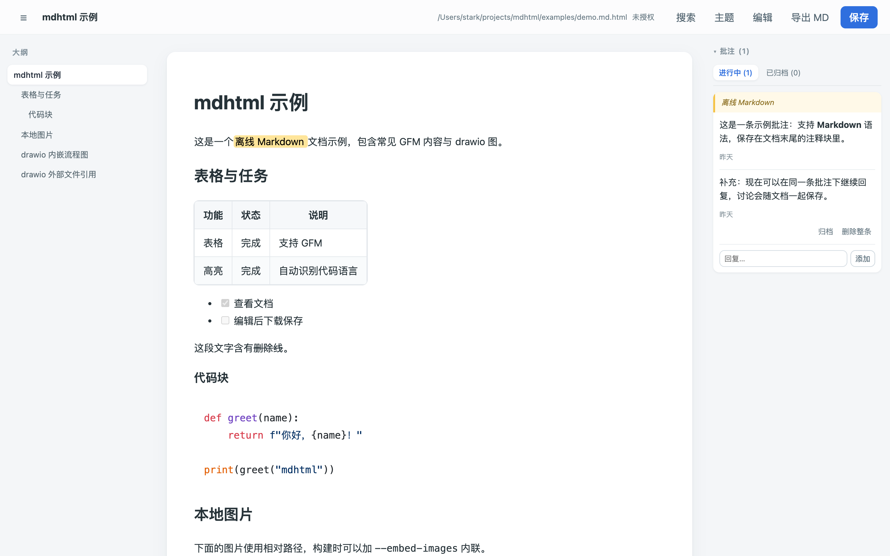
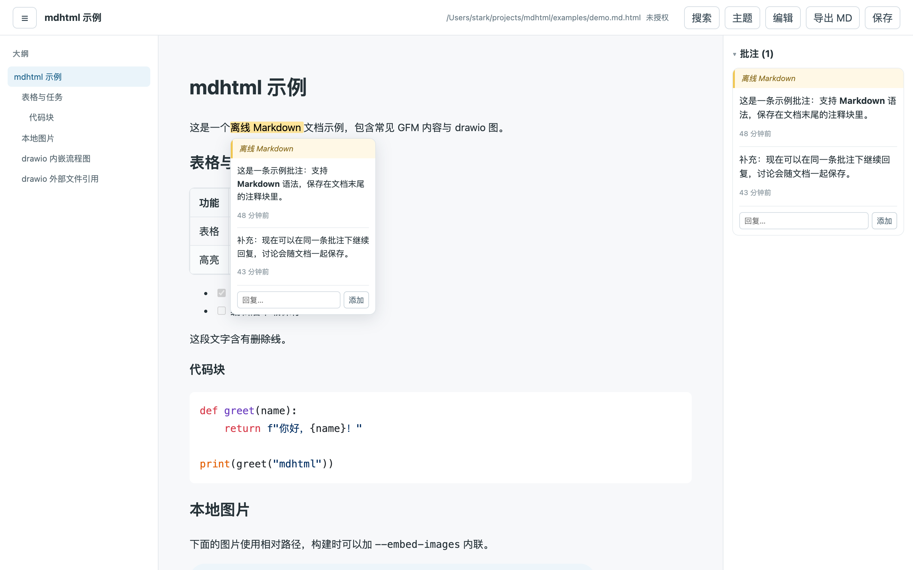
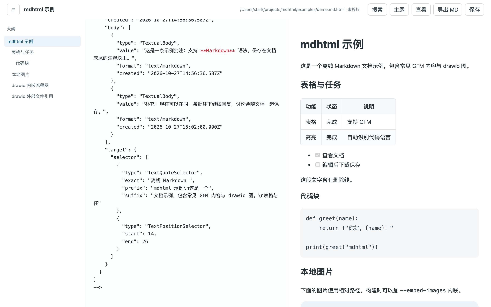
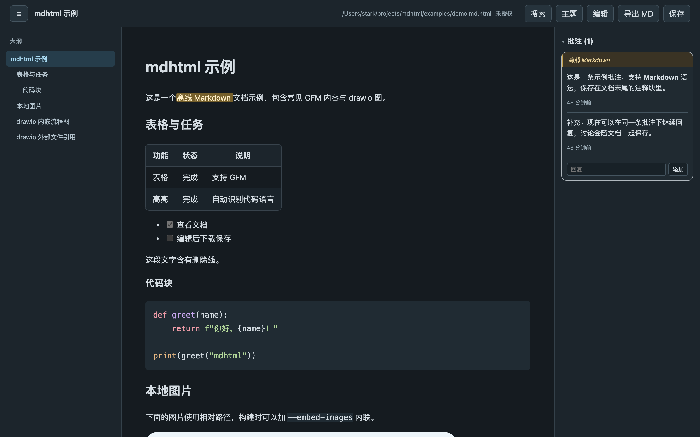

# mdhtml

一个 HTML 就是一个 md：把 Markdown 转成单文件、自包含、可离线使用的 HTML 文档，浏览器打开即可查看、编辑、批注，保存即原地覆写自身（quine 模式）。

## 功能

- **查看**：GFM 表格/任务列表、代码高亮、左侧大纲、drawio 图（浏览器内渲染）、暗色主题、全文搜索
- **编辑**：Markdown 源码 + 实时预览分屏，编辑界面带语法高亮
- **批注**：划词批注，W3C Web Annotation 格式，附带在 md 源码末尾的 HTML 注释块里，extract 不丢
- **保存**：File System Access API 原地覆写（Chrome/Edge），其他浏览器降级为下载覆盖
- **单文件**：应用代码、渲染库、文档数据全部内联，零 CDN 依赖；图片可选 base64 内联

## 截图

| 查看（大纲 / 表格 / drawio / 批注高亮） | 批注气泡与多轮回复 |
|---|---|
|  |  |

| 编辑（语法高亮 + 实时预览分屏） | 暗色主题 |
|---|---|
|  |  |

## 使用

```bash
./mdhtml build 笔记.md              # 生成 笔记.md.html
./mdhtml build 笔记.md --embed-images   # 本地图片转 base64 内联
./mdhtml extract 笔记.md.html       # 还原纯 Markdown（含批注注释块）
./mdhtml check 笔记.md.html         # 校验文件完整性
```

生成的 `.md.html` 用 Chrome/Edge 打开，点「保存」授权一次后即可原地保存。

## 文件格式

```
xxx.md.html = 内联应用代码 + <script type="text/markdown"> 里的 md 源码
批注 = md 源码末尾的 <!-- mdhtml-annotations [...] --> 注释块（W3C JSON）
```

详细设计见 [docs/技术方案.md](docs/技术方案.md)。给 AI agent 用的操作指南见 [skills/mdhtml/SKILL.md](skills/mdhtml/SKILL.md)（批注与 drawio 的格式和编辑流程）。

## 开发

```bash
node tests/anchors.js                  # 批注锚定测试
node tests/serialize-roundtrip.js      # 序列化往返测试
node tests/markdown-highlight.js       # 语法高亮测试
```

## 发布

维护者在干净的工作区运行 `scripts/release.sh x.y.z`。脚本会运行全部 JavaScript 测试和 examples 自检，生成 `dist/mdhtml-skill-vx.y.z.tar.gz` 和 `dist/mdhtml-vscode-vx.y.z.vsix`，并在本地创建 `vx.y.z` tag；确认产物后按脚本提示手动推送 tag、创建 GitHub Release。

使用者下载对应的 tar.gz，解压到 `~/.hermes/skills/` 或 `~/.claude/skills/` 即可。解压后得到 `mdhtml/` 目录，其中的 `mdhtml` CLI、模板和 vendor 资源同级，可直接运行 `mdhtml/mdhtml build mdhtml/examples/demo.md`。

VSCode 扩展可通过 `code --install-extension dist/mdhtml-vscode-vx.y.z.vsix` 安装，或在 VSCode 扩展面板的「…」菜单里选择「从 VSIX 安装」。
